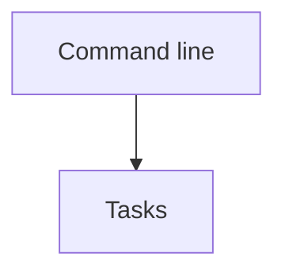

# Dependencies

Generated by `npm run docs:dependencies` from the relative imports in `features/`. Do not edit it by hand: `npm run check` fails when it is out of date.

## Features

An arrow points from a feature to a feature it imports. Before changing a feature, check what uses it.

| Feature | Uses | Used by |
| --- | --- | --- |
| [Command line](features/cli/SPEC.md) | tasks | — |
| [Tasks](features/tasks/SPEC.md) | — | cli |

## Modules

| File | Relative imports |
| --- | --- |
| `features/cli/format.mjs` | `features/tasks/tasks.mjs` |
| `features/cli/main.mjs` | `features/cli/format.mjs`, `features/tasks/tasks.mjs` |
| `features/tasks/tasks.mjs` | — |
