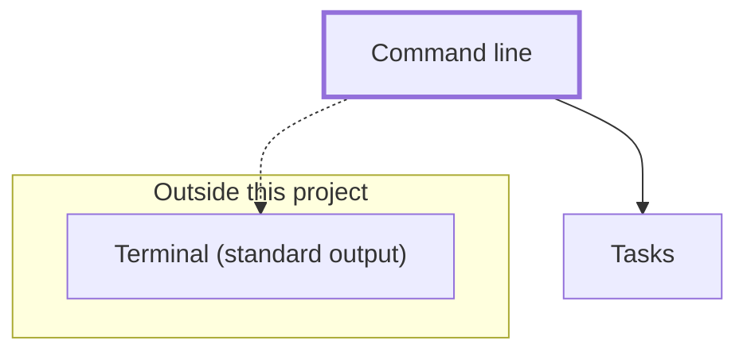

# Command line

Prints a task list in the terminal. It is the only part of the example that produces output, and it uses the Tasks feature for every rule. This is an example feature; replace it with your own.

## Behavior

- `npm start` prints an example list: open tasks first, then completed ones.
- Open tasks print as `[ ] <id>. <title>` and completed ones as `[x] <id>. <title>`, in list order.
- When nothing is open, the Open section says "Nothing left to do." The Completed section is left out when it would be empty.

## Interfaces

- **Serves:** None.
- **Handles:** None.
- **Stores:** None.
- **Uses:** `addTask`, `completeTask`, `openTasks` and `completedTasks` from [tasks](../tasks/SPEC.md).
- **External:** Terminal (standard output).

## Boundaries

- Owns presentation only: `format.mjs` turns a list into text and `main.mjs` is the entry point.
- Never decides what counts as open or done; it asks the Tasks feature.
- Tests live in `test/cli.test.mjs`.

## Verification

Run `npm test`, then `npm start` and read the output.

<!-- dependencies:start -->
## Dependencies

Generated by `npm run docs:generate` from the code's imports and the Interfaces sections of the feature specs; do not edit it by hand. Solid arrows are imports. Dotted arrows are calls at runtime, labeled with what is called, and outside services. The [project dependency map](../../DEPENDENCIES.md) shows every feature together.

- **Imports:** [tasks](../tasks/SPEC.md)
- **Calls:** None.
- **Used by:** None.
- **Outside services:** Terminal (standard output)

<!-- dependencies:end -->
