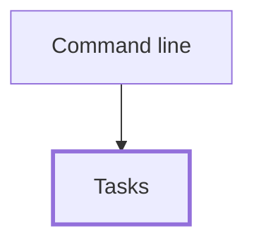

# Tasks

Keeps a list of tasks and the rules for changing it: adding, completing and splitting the list into open and completed. This is an example feature; replace it with your own.

## Behavior

- `addTask` trims the title and appends the task with the next free id. A blank title is rejected with an error.
- `completeTask` marks one task done. An unknown id is rejected with an error and the list is unchanged.
- `openTasks` and `completedTasks` keep the list's order.
- Every function returns a new list and leaves the one it was given untouched.

## Interfaces

- **Serves:** None.
- **Handles:** None.
- **Stores:** None. Lists live wherever the caller keeps them.
- **Uses:** None.
- **External:** None.

## Boundaries

- Owns the task rules only. It does no printing, reading or saving; callers do that.
- Has no dependencies, so any feature can use it.
- Tests live in `test/tasks.test.mjs`.

## Verification

Run `npm test`. The task rules are pure functions, so the unit tests cover them fully.

<!-- dependencies:start -->
## Dependencies

Generated by `npm run docs:generate` from the code's imports and the Interfaces sections of the feature specs; do not edit it by hand. Solid arrows are imports. Dotted arrows are calls at runtime, labeled with what is called, and outside services. The [project dependency map](../../DEPENDENCIES.md) shows every feature together.

- **Imports:** None.
- **Calls:** None.
- **Used by:** [cli](../cli/SPEC.md) (imports it)
- **Outside services:** None.

<!-- dependencies:end -->
